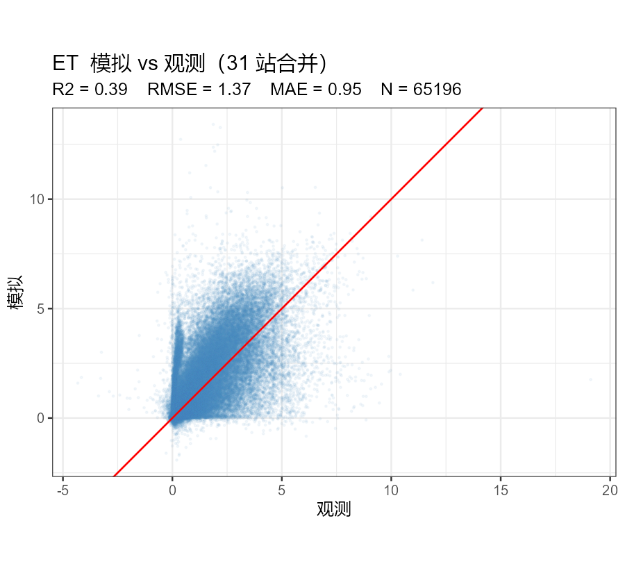
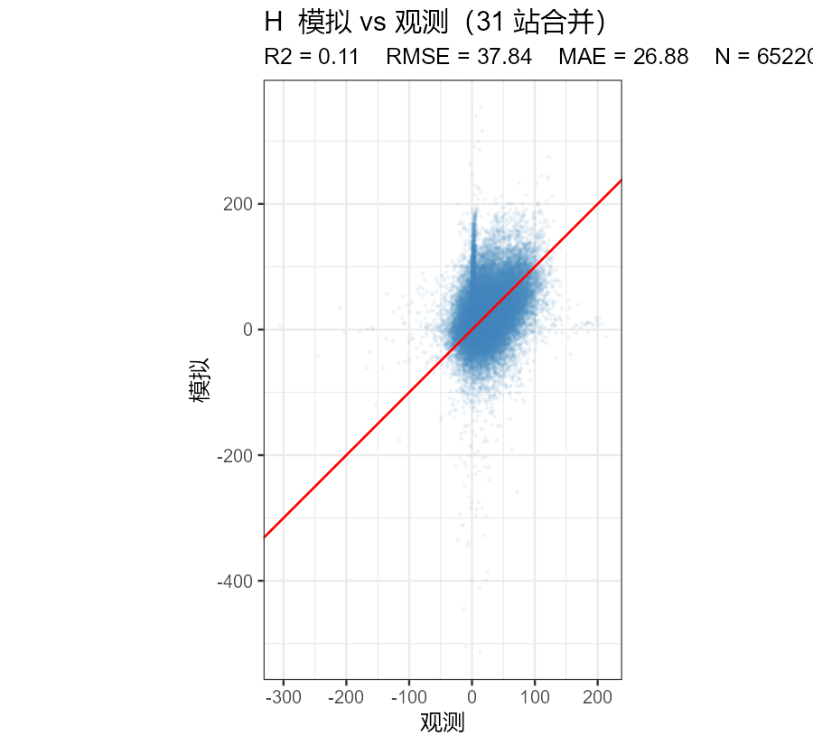
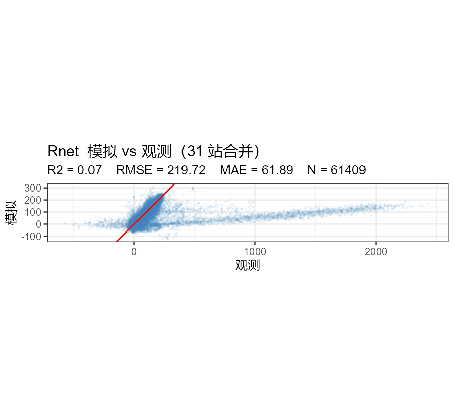
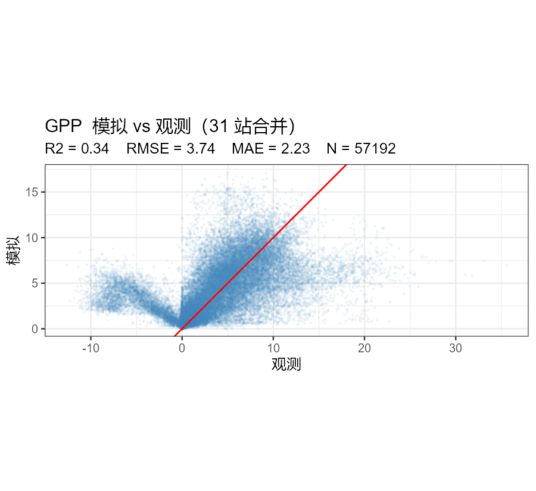
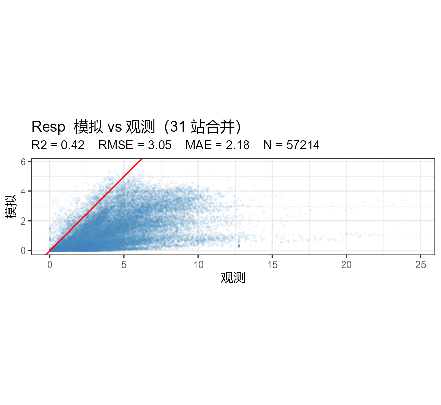
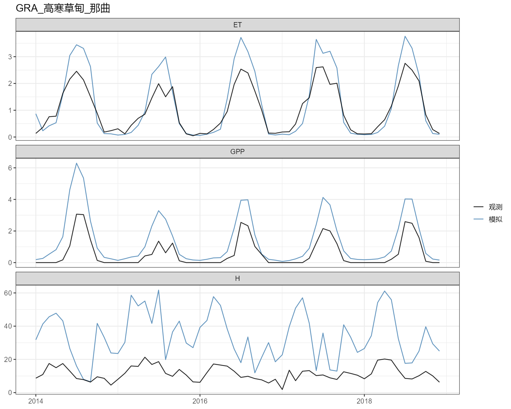
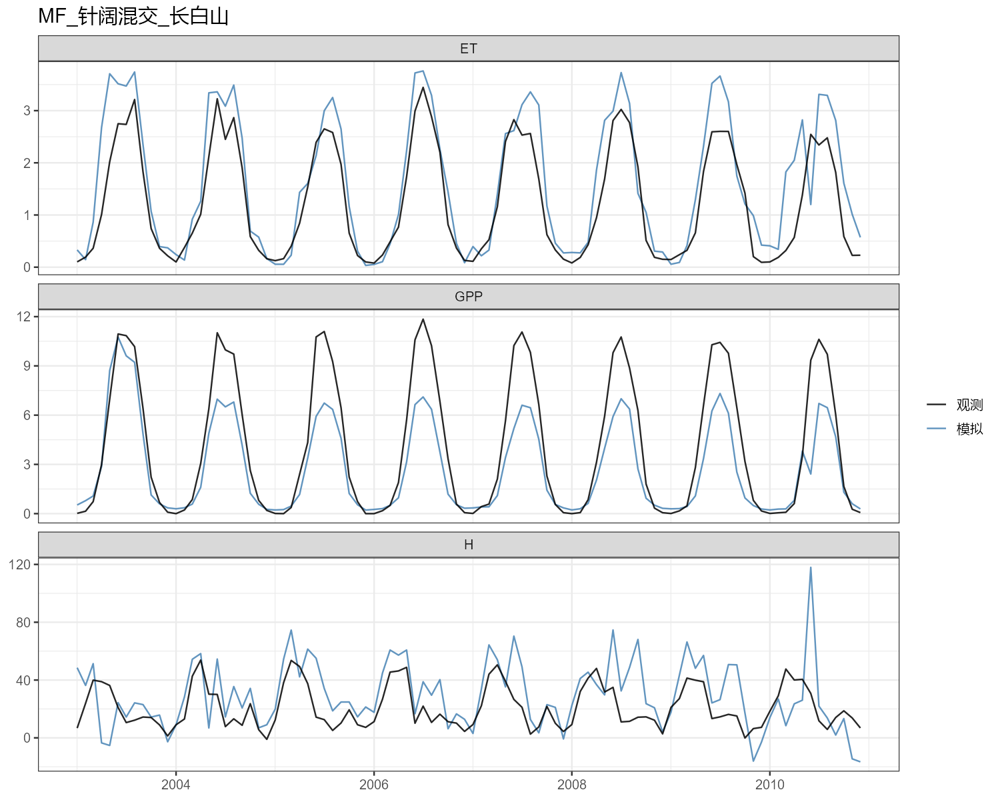
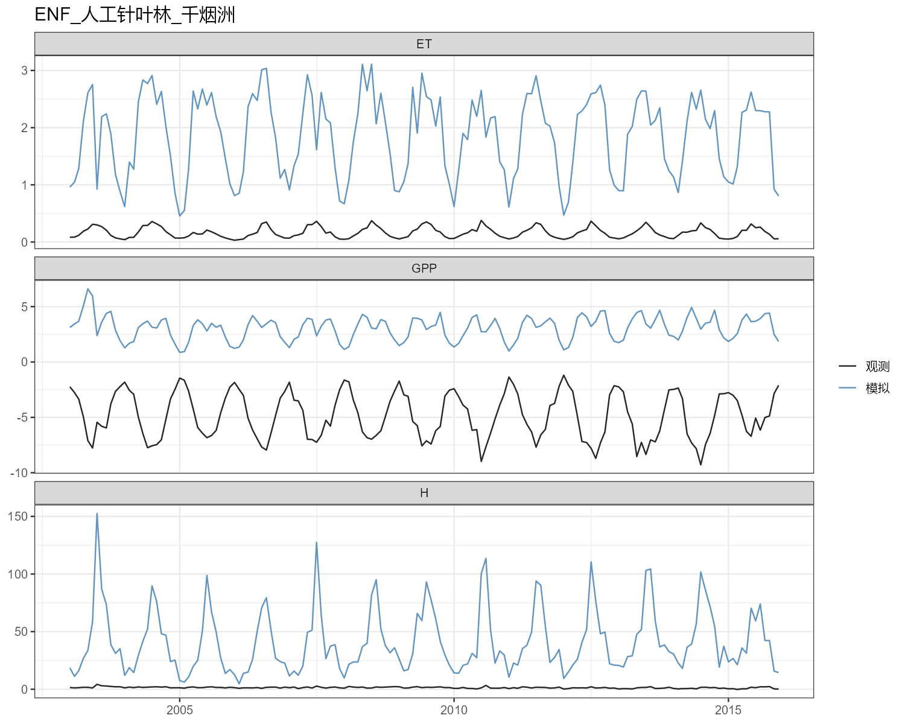
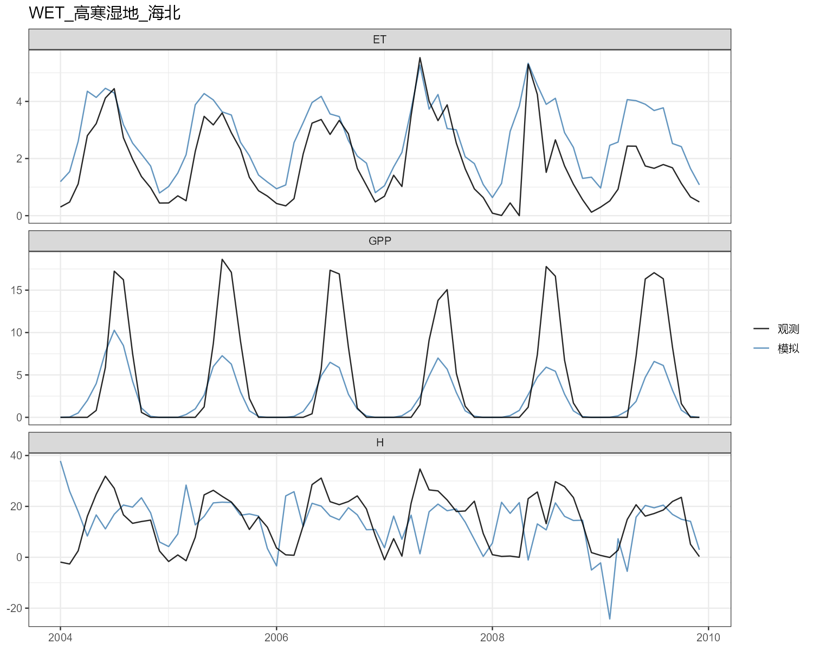

# CoLM 单点模拟验证报告（自己版本，31 站）

## 一、概述

- 模型：CoLM 单点（kernel `default`，LULC_IGBP，无 BGC/CROP）
- 站点：31 个 ChinaFlux 站（自己版本 = sp31 实测 + CMFD 补缺）
- 时段：各站自身观测时段（2003–2022）
- 观测：老师 ChinaFlux FluxSM 日尺度（39 站中取 31 站）
- 变量：ET / H / Rnet / GPP / Resp；**Qg 观测缺失，未做**
- 配置：`spinup_repeat=0`（含首年瞬变，未跳过）；逐时 history → 日尺度聚合

## 二、精度汇总

| 变量 | 站数 | R² 中位数 | R² 均值 | RMSE 中位数 | MAE 中位数 | Bias 中位数 |
|---|---|---|---|---|---|---|
| ET | 31 | 0.47 | 0.45 | 1.32 | 0.92 | 0.08 |
| H | 31 | 0.18 | 0.19 | 33.33 | 24.44 | -1.82 |
| Rnet | 30 | 0.86 | 0.76 | 30.64 | 25.70 | -15.93 |
| GPP | 28 | 0.53 | 0.51 | 2.54 | 1.77 | -0.05 |
| Resp | 28 | 0.61 | 0.58 | 1.93 | 1.56 | -1.55 |

*整体：Rnet 最好（R²≈0.86），Resp/GPP/ET 中等（0.5~0.6），H 最差（0.18，感热为能量平衡残差）*

## 三、每变量最佳 / 最差 3 站（R²，仅 N≥30 的站）

- **ET**：最佳——EBF_亚热带常绿阔叶林_金佛山 0.77；DBF_栓皮栎人工林_小浪底 0.76；GRA_高寒草甸_海北 0.73；最差——EBF_橡胶林_西双版纳 0.1；GRA_稀树草原_元江 0.15；CRO_水稻_长岭 0.16
- **GPP**：最佳——MF_针阔混交_长白山 0.82；GRA_高寒草甸_那曲 0.8；GRA_高寒草甸_海北 0.79；最差——EBF_热带雨林_西双版纳 0.13；EBF_橡胶林_西双版纳 0.14；EBF_橡胶林_海南儋州 0.22
- **H**：最佳——ENF_北方林森林_呼中 0.46；ENF_人工针叶林_千烟洲 0.42；MF_针阔混交_长白山 0.42；最差——CRO_冬小麦夏玉米_固城 0；CRO_水稻_长岭 0；GRA_高寒草甸_若尔盖 0.01
- **Resp**：最佳——ENF_人工针叶林_燕山 0.89；GRA_高寒草甸_海北 0.89；CRO_水稻_长岭 0.88；最差——CRO_水稻_句容 0.17；EBF_亚热带常绿阔叶林_金佛山 0.19；GRA_稀树草原_元江 0.23
- **Rnet**：最佳——EBF_亚热带常绿阔叶林_金佛山 0.97；DBF_天然栎林_宝天曼 0.97；ENF_人工针叶林_千烟洲 0.96；最差——EBF_热带雨林_西双版纳 0.04；EBF_橡胶林_西双版纳 0.07；SAV_荒漠草原_达茂 0.12

## 四、图

### 散点图（31 站合并，1:1 线）

### 时间序列（代表站，逐月平均）

## 五、注意事项

1. **长岭（水稻）太阳辐射异常**：老师 sp31 数据里长岭 7 月 Rs 仅 40 W/m²（正常约 200），导致其 ET/H/Rnet 精度差（R² 0.16/0.001/0.16），但 GPP/Resp 尚可（0.64/0.88）。该站按正常参与统计，未剔除。
2. **缺观测的站/变量**：GPP/Resp——临泽、多伦、锡林浩特刈割（观测无此列）；Rnet——三江源（无 Rn 列）。这些组合自动为 NA，不参与该变量的中位数。
3. **燕山两站 Rn 仅 3 个有效天**：燕山灌丛、燕山针叶林的 Rn 列 99.6% 缺测，Rnet 用 N=3 计算，统计上不可靠（R²=0.99 属偶然）。
4. **首年瞬变（spinup=0）**：每站第 1 年有土壤水排水/蓄水瞬变（首年 7 月 ET 与后续年中位数比 1.18，方向不一），本次按「不跳首年」口径统计。
5. **H 整体偏低**：感热是能量平衡残差，辐射/潜热误差累积到 H，R² 普遍低（中位数 0.18），属单点通量模拟常见现象。
6. **单位口径**：观测已换算——能量通量 W/m²（老师 FluxSM 的 Rn/Hs/LE 本就是 W/m²）、碳通量 gC/m²/d（÷12×1e6÷86400 → µmol/m²/s）、ET mm/d。
7. **kernel 无 BGC/CROP**：GPP 为光合碳同化（f_assim）、Resp 为自养呼吸（f_respc），不含异养呼吸/作物模块；水稻/农田站（长岭、盘锦等）无灌溉与作物物候。
